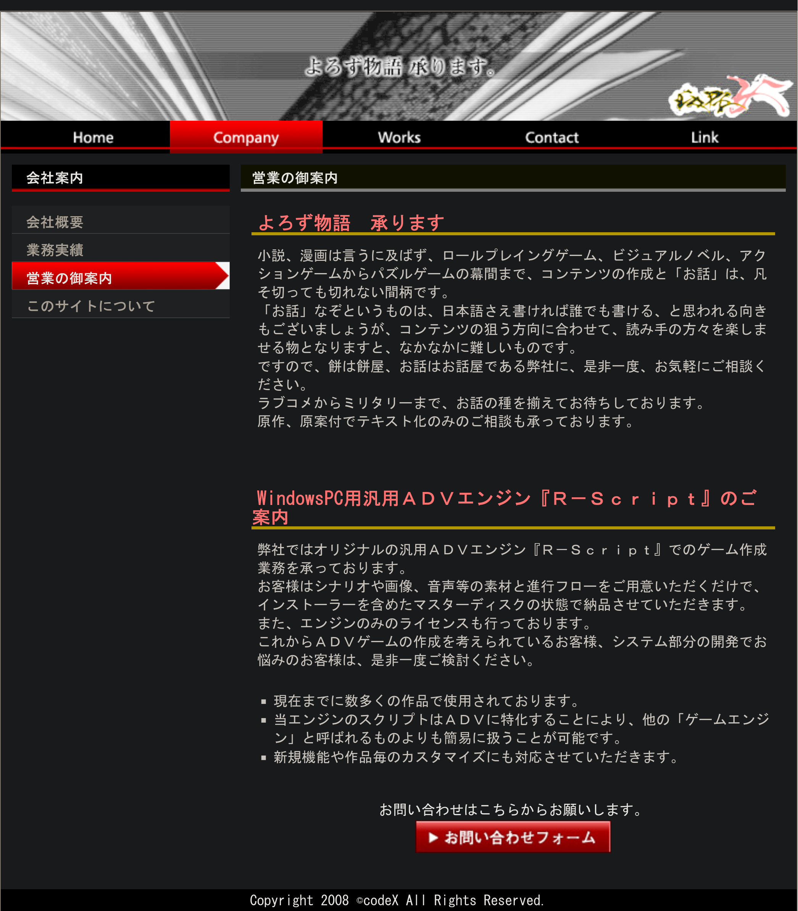

# LiarsoftTool

[中文](README.zh.md) | [English](README.en.md) | [Русский](README.ru.md) | [日本語](README.ja.md)



CodeX RScript エンジンを使うゲームのリソースを扱うツールです。Liar-soft、raiL-soft などの作品で、アーカイブの展開・作成、画像・音声の変換、スクリプトの抽出・書き戻しに使用できます。現在、ゲーム EXE の変換は提供していません。

Ren'Py への移植には、[rscript2renpy](https://github.com/Love-in-idleness/rscript2renpy) を併用してください。

## 使い始める

Windows 版は GUI と CLI をそれぞれ圧縮済みの単一 EXE で配布します。必要な方をダウンロードして実行してください。展開は不要です。Linux 版の GUI は `liarsofttool-gui`、CLI は `liarsofttool` です。

作業前にゲームリソースをコピーしてください。出力先の既定値は入力ファイルと同じ場所です。再変換で同名ファイルが上書きされることがあります。

1. ファイルまたはフォルダーを追加します。ウィンドウへのドラッグにも対応します。
2. 「Preferences」でリソースの文字コードを選びます。日本語は通常 CP932、中国語パッチは通常 GBK です。
3. 再帰処理、展開のみ、作成のみを必要に応じて指定し、「Conversion tasks」で出力先を確認します。
4. 変換を開始します。問題が起きた場合は「Copy details」で詳細をコピーしてください。

GUI・CLI とも、既定では GSC を TSC に変換します。テキストのみ抽出する場合は GUI の **GSC→TXT** を有効にします。

**Check for updates** から新しいバージョンを確認し、GitHub のリリースページを開けます。起動時の通信や、自動ダウンロード・インストールは行いません。

## リソースを閲覧する

「Resource browser」でフォルダー、XFL、LWG を開きます。項目をダブルクリックすると、子フォルダーや入れ子のアーカイブに移動できます。選択した画像・音声・テキストのプレビューと、GSC の読み取り専用 TSC 表示に対応します。文字化けする場合は文字コードを切り替えてください。TSC は常に UTF-8 で読みます。未対応・破損ファイルでも、ページ単位の 16 進表示を利用できます。

閲覧とプレビューは元ファイルを変更せず、アーカイブ全体を展開しません。「Export raw bytes」は選択項目だけを変換せずに書き出します。アーカイブ内の項目を変換するには、先に書き出してから変換タスクへ追加してください。単独ファイルは直接追加できます。

画像は拡大縮小と透明背景表示に対応します。音声は再生、一時停止、シーク、音量調整が可能です。音声プレビューには GTK のメディアバックエンドと GStreamer の Ogg/Vorbis プラグインが必要です。Windows GUI には同梱しています。

## コマンドラインのヘルプ

対応形式、引数、変換例はソフトウェア内のヘルプを参照してください。

```bash
liarsofttool -h
```

## スクリプトを翻訳する

台詞のみを編集する場合は TXT を使い、`>` の後に訳文を入力し、元の GSC を参照して書き戻します。スクリプト全体を編集する場合は TSC の命令や文字列を変更して再コンパイルします。

TSC は UTF-8 で保存し、GSC の生成時にゲームに合う文字コードを選びます。CP932 / Windows-31J、GBK、GB18030、Big5 / CP950、韓国語 CP949、Windows CP1250–CP1258、UTF-8 に対応します。変換とプレビューで同じ文字コード一覧を使用します。

GSC→TSC は実験的機能です。すべてのゲームに対応するわけではありません。元の GSC を保存し、自動生成されたラベルとメタデータを削除しないでください。命令の一覧は [TSC 命令リファレンス](docs/GSC_OPCODE_REFERENCE.ja.md)を参照してください。

## ソースからビルドする

C++17 コンパイラー、CMake、WebP、Vorbis/Ogg、libcurl 7.85 以降が必要です。GUI には GTK4 4.10、libadwaita 1.5 以降、gettext も必要です。Windows と Linux は共通 GUI を使用します。変換設定、テーマ、表示言語は「Preferences」にあります。テーマはシステム連動・ライト・ダーク、GUI の言語は中国語・英語・ロシア語・日本語です。言語の手動変更は再起動後に反映されます。

Debian / Ubuntu:

```bash
sudo apt install build-essential cmake pkg-config libwebp-dev libvorbis-dev libogg-dev libcurl4-openssl-dev libgtk-4-dev libadwaita-1-dev gettext gstreamer1.0-plugins-base gstreamer1.0-plugins-good
cmake -S . -B build -DCMAKE_BUILD_TYPE=Release
cmake --build build -j2
```

実行ファイルは `build/` に生成されます。CLI のみなら、構成時に `-DBUILD_GUI=OFF` を指定します。Windows は[ビルド手順](docs/BUILDING.ja.md)を参照してください。

## 関連資料

[RScript Runtime](runtime/README.ja.md) は独立した実験的 Windows ランチャーと任意 DLL です。同系 RScript エンジンで展開済み資源と UTF-8 スクリプトを優先装入し、ゲーム whitelist でなくインターフェースを使って接続します。

[文書一覧](docs/README.ja.md) · [TSC 命令リファレンス](docs/GSC_OPCODE_REFERENCE.ja.md) · [開発計画](docs/ROADMAP.ja.md)

正当に入手したゲームリソースを使用してください。変換に成功しても、すべてのエンジンで使えるとは限りません。ゲームへ戻した後の動作を確認してください。

## ライセンスと謝辞

LiarsoftTool は GPLv3 です。第三者のコンポーネントには、それぞれのライセンスが適用されます。

- [RaiLTools](https://github.com/EusthEnoptEron/RaiLTools): アーカイブ・スクリプト形式の研究。
- [arc_unpacker](https://github.com/vn-tools/arc_unpacker): GPLv3 の画像展開コード。
- [GARbro](https://github.com/crskycode/GARbro): WCG エンコードの参考。
- [stb](https://github.com/nothings/stb): 画像の読み書き。
- [WebP](https://chromium.googlesource.com/webm/libwebp/): 可逆 WebP。
- [Ogg / Vorbis](https://xiph.org/vorbis/): 音声。[ライセンス原文](docs/THIRD_PARTY_AUDIO_LICENSES.md)。
- [GTK4 / libadwaita](https://www.gtk.org/): 共通デスクトップ GUI。
- [GStreamer](https://gstreamer.freedesktop.org/): GTK メディアバックエンドの音声プレビュー。
- [libcurl](https://curl.se/libcurl/): HTTPS による更新確認。
